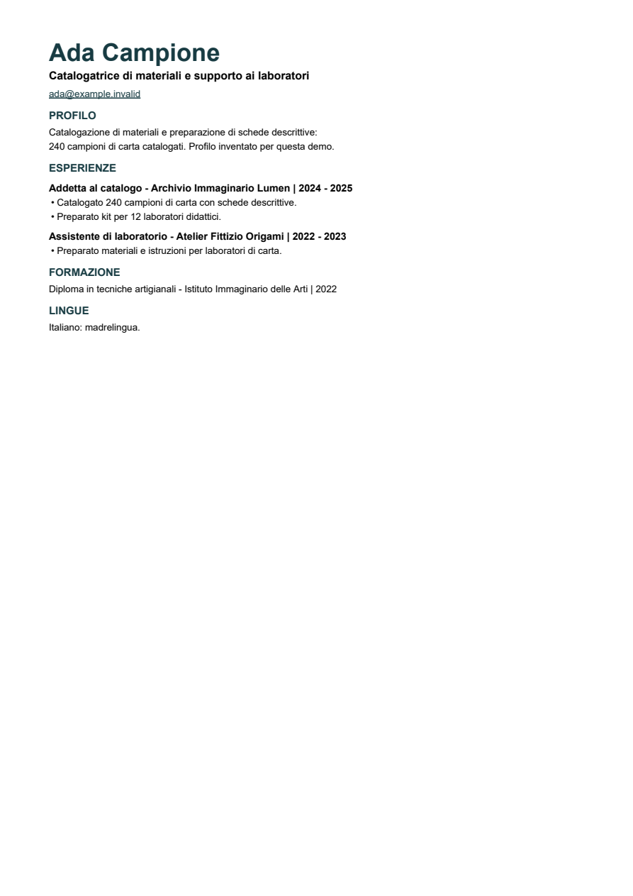

# Demo sintetica: da un annuncio al CV

Persona, organizzazioni, date e risultati sono interamente inventati.
La fase di adattamento è una **risposta sintetica predisposta**, non una chiamata
live a un modello. PDF, PNG e controlli sono generati davvero dal progetto.

1. [Annuncio](../examples/annuncio.md): catalogazione e schede descrittive obbligatorie.
2. [Master](../examples/master.md): le evidenze disponibili, prima della selezione.
3. [Mappa requisiti/prove](../examples/requisiti.csv): due dimostrati, uno da verificare.
4. [CV risultante](CV.md) e [PDF](CV.pdf): stessi fatti, punti selezionati per il ruolo.
5. [Controlli eseguiti](controlli.json): pagine, copertura lessicale e metadati.

La proposta porta in alto catalogazione e schede, elimina due punti meno pertinenti
e mantiene titoli, date e formazione. Non attribuisce il taglio laser, non documentato.
Fit qualitativo favorevole sui due obbligatori; niente punteggio senza scorecard
configurata. Retribuzione e seniority restano domande aperte. Nessuna candidatura inviata.

Riproduci con `python scripts/demo.py --check` dalla radice. La CI confronta gli
artefatti con una nuova generazione, senza credenziali e senza aggiornare tracker.
La qualità delle risposte AI e Canva live non è dimostrata da questo esempio.
